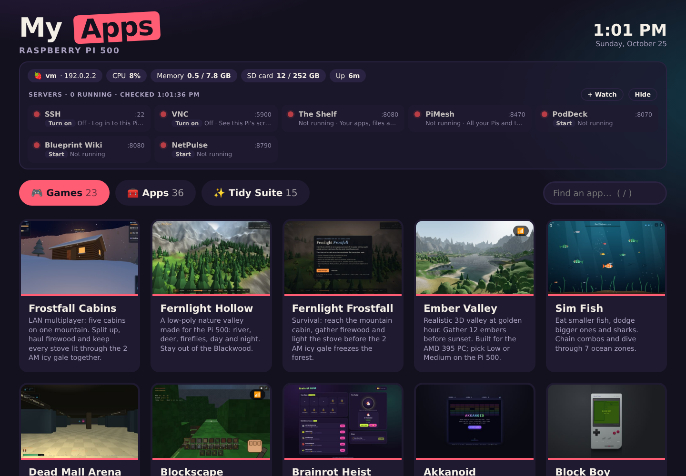

# My Apps for the Raspberry Pi 500

A clickable menu of all my apps and games for the Pi 500, with server lights at the top.

- **Games**, **Apps** and the **Tidy Suite** as big tiles (arrow keys, Enter, `/` to search)
- **Server lights**: this Pi's temperature, CPU, memory, storage and power, plus a green/red light
  for every server (SSH, VNC, The Shelf, PiMesh, PodDeck, Blueprint Wiki, NetPulse, Pip, ...)
- **Stop buttons**: shut down any running web server one at a time (click, then confirm)
- **RPi500+ Task Manager**: Windows-style Task Manager (Ctrl+Shift+Esc) with an Update everything button
- **Pip**: offline voice assistant for your headset
- **Overdrive**: show off every part of the Pi 500 and get a score
- **RAID Forge**: point-and-click RAID 0/1/5/6/10 on USB 3 drives or a drive HAT, can move the whole system onto the RAID, with a safe demo mode
- **PiDroid Setup**: get Waydroid (Android) and Roblox running, with a fix button for every check
- **Pi 500 games**: Fernlight Hollow, Fernlight Frostfall and Dead Mall Arena LAN Edition with Pi graphics

## Set up
Unzip it on the Pi and run `Set Up My Apps.sh` once (double-click, then *Execute in Terminal*).
It puts the folder on the Desktop, adds a My Apps icon to the Desktop and menu, icons for the apps
that run as small programs, starts the server-lights helper (`status/pi-status.py`, which only
listens on 127.0.0.1), and asks before installing the Task Manager and Pip.

See `READ ME FIRST.txt` for every app.
